# Entity-Relationship Diagram

All 19 tables in the schema, derived directly from `Models/ApplicationDbContext.cs`
(`OnModelCreating`) and each model's `[ForeignKey]` attributes — not from naming convention,
since several foreign keys use non-conventional names that EF's default convention wouldn't
infer on its own (see [Notable relationships](#notable-relationships) below).

```mermaid
erDiagram
    ROLE ||--o{ USER : "has many"
    USER ||--o| USER : "assigned doctor (Assistant/Patient -> Doctor)"

    USER ||--o{ PATIENT : "registers (optional, front desk)"
    USER ||--o| PATIENT : "portal login (optional, one-to-one)"
    PATIENT ||--o{ PATIENT : "guardian of (dependent/pediatric)"

    PATIENT ||--o{ ADMISSION : "has"
    USER ||--o{ ADMISSION : "admits (doctor)"
    ADMISSION ||--o{ BEDTRANSFER : "has"
    BED ||--o{ BEDTRANSFER : "assigned via"

    PATIENT ||--o{ APPOINTMENT : "books"
    USER ||--o{ APPOINTMENT : "sees (doctor)"
    APPOINTMENT ||--o| PATIENTVITAL : "vitals for (optional)"
    APPOINTMENT ||--o{ MEDICALRECORD : "documented in (optional)"
    APPOINTMENT ||--o{ PRESCRIPTION : "for (optional)"

    PATIENT ||--o{ PATIENTVITAL : "has"
    USER ||--o{ PATIENTVITAL : "records (assistant)"

    PATIENT ||--o{ MEDICALRECORD : "has"
    USER ||--o{ MEDICALRECORD : "writes (doctor)"

    PATIENT ||--o{ PATIENTALLERGY : "has"
    USER ||--o{ PATIENTALLERGY : "records"

    PATIENT ||--o{ PRESCRIPTION : "receives"
    USER ||--o{ PRESCRIPTION : "writes (doctor)"
    USER ||--o{ PRESCRIPTION : "dispensed by (pharmacist, optional)"
    USER ||--o{ PRESCRIPTION : "discontinued by (doctor, optional)"
    PRESCRIPTION ||--o{ PRESCRIPTIONITEM : "contains"
    MEDICINE ||--o{ PRESCRIPTIONITEM : "prescribed as"
    MEDICINE ||--o{ MEDICINEBATCH : "stocked in batches"

    PATIENT ||--o{ BILL : "billed"
    ADMISSION ||--o| BILL : "for (optional)"
    USER ||--o{ BILL : "approves discount (optional)"
    BILL ||--o{ BILLITEM : "contains"
    BILL ||--o{ PAYMENTTRANSACTION : "paid via"
    USER ||--o{ PAYMENTTRANSACTION : "processed by (cashier, optional)"

    PATIENT ||--o{ AISUGGESTION : "subject of"
    USER ||--o{ AISUGGESTION : "reviews (optional)"

    PATIENT ||--o{ OPERATION : "undergoes"
    USER ||--o{ OPERATION : "performs (surgeon)"

    USER ||--o{ AIPROVIDERSETTING : "updates (optional)"

    ROLE {
        int Id PK
        string RoleName
        string Permissions
    }
    USER {
        int Id PK
        int RoleId FK
        string Username UK
        string PasswordHash
        string FullName
        int AssignedDoctorId FK "nullable, self-ref"
    }
    PATIENT {
        int Id PK
        string Uhid UK
        bool IsChild
        string FullName "nullable for infants"
        int RegisteredById FK "nullable"
        int UserId FK "nullable, unique - portal login"
        int GuardianPatientId FK "nullable, self-ref"
        string GuardianRelationship "nullable"
    }
    BED {
        int Id PK
        string BedNumber UK
        BedCategory Category
        decimal DailyRate
    }
    BEDTRANSFER {
        int Id PK
        int AdmissionId FK
        int BedId FK
        datetime StartDate
        datetime EndDate "null while occupied"
    }
    ADMISSION {
        int Id PK
        int PatientId FK
        int AdmittingDoctorId FK
        datetime AdmissionDate
        datetime DischargeDate "nullable"
    }
    APPOINTMENT {
        int Id PK
        int PatientId FK
        int DoctorId FK
        datetime AppointmentDatetime
        datetime EndTime
        AppointmentStatus Status
        uint Version "xmin concurrency token; slot unique index ix_appointments_doctor_slot_active"
    }
    OPERATION {
        int Id PK
        int PatientId FK
        int SurgeonId FK
        datetime OperationDatetime
        OperationStatus Status
    }
    MEDICINE {
        int Id PK
        string Name
        string GenericName
        decimal UnitPrice
        int StockQuantity
    }
    MEDICINEBATCH {
        int Id PK
        int MedicineId FK
        string BatchNumber
        datetime ExpiryDate
        int QuantityRemaining
        int InitialQuantity
        datetime CreatedAt
        datetime UpdatedAt
    }
    PRESCRIPTION {
        int Id PK
        int PatientId FK
        int DoctorId FK
        int AppointmentId FK "nullable"
        PrescriptionStatus Status
        bool IsBilled
        int DispensedById FK "nullable"
        datetime DispensedAt "nullable"
        int DiscontinuedById FK "nullable"
        datetime DiscontinuedAt "nullable"
        string SafetyOverrideReason "nullable"
        string SafetyWarningsJson "nullable"
    }
    PRESCRIPTIONITEM {
        int Id PK
        int PrescriptionId FK
        int MedicineId FK
        int Quantity
        decimal UnitPrice
    }
    BILL {
        int Id PK
        int PatientId FK
        int AdmissionId FK "nullable"
        int DiscountApprovedById FK "nullable"
        decimal SubtotalAmount
        decimal DiscountAmount
        decimal NetTotal
        decimal PaidAmount
        BillStatus Status
        uint Version "xmin concurrency token"
    }
    BILLITEM {
        int Id PK
        int BillId FK
        DepartmentType Department
        decimal Amount
    }
    PAYMENTTRANSACTION {
        int Id PK
        int BillId FK
        decimal Amount
        string PaymentMethod
        string TransactionId "nullable, filtered unique index for idempotency"
        int ProcessedById FK "nullable"
        datetime TransactionDate
        string Notes "nullable"
        string PreviousHash "SHA-256 cryptographic chain"
        string RowHash "SHA-256 cryptographic chain"
    }
    PATIENTVITAL {
        int Id PK
        int PatientId FK
        int AppointmentId FK "nullable"
        int RecordedById FK
        int SystolicBp
        int DiastolicBp
        int HeartRate
        int RespiratoryRate
        decimal Spo2
        decimal Temperature
        decimal WeightKg "nullable, 0.5-350kg for pediatric dosing"
        bool OnSupplementalOxygen
        ConsciousnessLevel Consciousness
        decimal BloodSugar "nullable"
        int TriageScore "nullable, NEWS2 score"
        TriagePriority TriagePriority "nullable, NEWS2 output"
    }
    MEDICALRECORD {
        int Id PK
        int PatientId FK
        int DoctorId FK
        int AppointmentId FK "nullable"
        string Diagnosis
        string Treatment
    }
    PATIENTALLERGY {
        int Id PK
        int PatientId FK
        string Substance
        string AllergenGenericName "nullable"
        string ReactionType "nullable"
        AllergySeverity Severity
        int RecordedById FK
    }
    AISUGGESTION {
        int Id PK
        int PatientId FK
        int ReviewedById FK "nullable"
        AiSuggestionVerdict Verdict
        int InputTokens
        int LatencyMs
    }
    AIPROVIDERSETTING {
        int Id PK
        AiProviderType Provider UK
        string EncryptedApiKey
        int Priority
        int UpdatedById FK "nullable"
    }
```

## Notable relationships

A handful of foreign keys break from EF's naming convention (`{Property}Id` matching a
navigation property of the same base name), which is worth knowing before reading the model
files cold:

| Entity.Property | Points at | Why the name differs / Special Configuration |
|---|---|---|
| `Admission.AdmittingDoctorId` | `User` | Distinguishes the admitting doctor from a future `AttendingDoctor` or similar |
| `Operation.SurgeonId` | `User` | Domain-specific role name, not a generic "doctor" |
| `Bill.DiscountApprovedById` | `User` | Records *who* approved a discount, for audit — not who created the bill |
| `PaymentTransaction.ProcessedById` | `User` | Staff member or cashier who processed or received the payment (`Restrict`) |
| `PaymentTransaction.BillId` | `Bill` | Ledger line items belonging to an invoice (`Cascade`) |
| `Prescription.DispensedById` | `User` | Pharmacist who dispensed the prescription and adjusted stock (`Restrict`) |
| `Prescription.DiscontinuedById` | `User` | Doctor who cancelled or discontinued the prescription therapy (`Restrict`) |
| `Prescription.AppointmentId` | `Appointment` | Optional appointment context; configured with `OnDelete(SetNull)` so deleting an appointment does not purge prescription audit trails |
| `AiSuggestion.ReviewedById` | `User` | The clinician who Accepted/Edited/Rejected — null while `Verdict == Pending` |
| `PatientVital.RecordedById` / `PatientAllergy.RecordedById` | `User` | Whoever recorded the observation, not necessarily the treating doctor |
| `AiProviderSetting.UpdatedById` | `User` | Audit trail for who last changed a provider's key/priority |
| `User.AssignedDoctorId` | `User` (self-referencing) | Links an Assistant to their doctor's chamber, or a Patient's care team context |
| `Patient.GuardianPatientId` | `Patient` (self-referencing) | Links a pediatric dependent to their parent/guardian patient account (`Restrict`) |
| `Patient.RegisteredById` vs `Patient.UserId` | Both `User`, different meanings | `RegisteredById` is the staff member (receptionist/admin) who registered the patient; `UserId` is the patient's *own* portal login, if one was issued — two independent, both-nullable links to the same table |

All clinical and user relationships use `OnDelete(DeleteBehavior.Restrict)` rather than the EF default
(`Cascade`) — deleting a `User` who admitted a patient, approved a discount, recorded vitals, dispensed medications, or reviewed an AI suggestion must fail loudly rather than silently cascading into clinical or financial history.

## Concurrency tokens and shadow columns

- **PostgreSQL `xmin` Concurrency Tokens:** `Appointment.Version` and `Bill.Version` map PostgreSQL's native `xmin` hidden system column via `.Property(x => x.Version).IsRowVersion()`. EF Core includes `xmin` in `WHERE` clauses of `UPDATE` queries to guarantee atomic collision detection (e.g. double-booking a doctor's slot or simultaneous bill payments).
- **Allergy Normalization Shadow Column:** `PatientAllergy` includes a computed shadow column `SubstanceNormalized` defined as `lower(btrim("Substance"))` with a unique composite index on `(PatientId, SubstanceNormalized)`, preventing duplicate allergy entries regardless of case or whitespace variance.

## Surgical Theatre & Multi-Resource Scheduling

`Operation` is fully implemented and wired end-to-end via `OperationsController`:
- **Three Simultaneous Resource Constraints:** (1) Verifies the lead surgeon has no outpatient clinic appointments or concurrent surgeries via `DoctorScheduleService`; (2) Verifies the Operating Theatre room is free during the surgical window; and (3) Automatically earmarks an unoccupied `ICU` or `Cabin` recovery bed via `BedTransfer` under the patient's `Admission`.
- **Clinical Lifecycle:** Tracks surgical procedures through `Scheduled` -> `InSurgery` -> `Recovery` -> `Completed` status transitions with pre-op checklist verification and automatic billing integration in `BillsController`.

