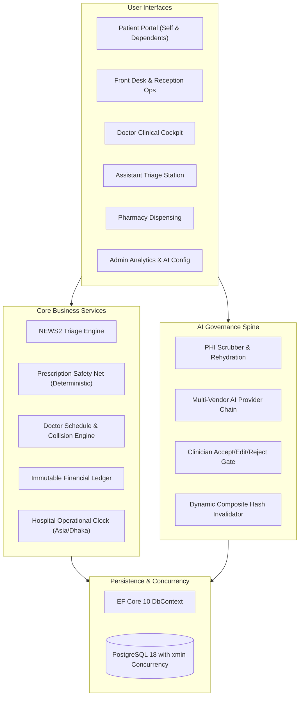
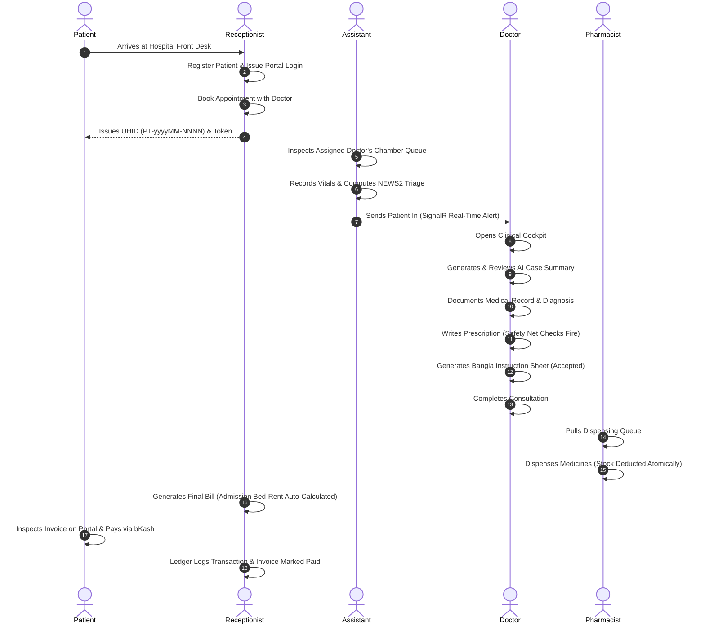
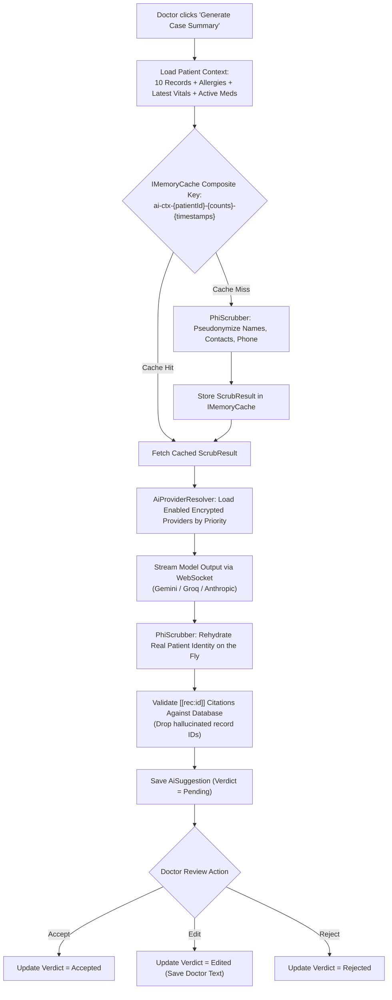
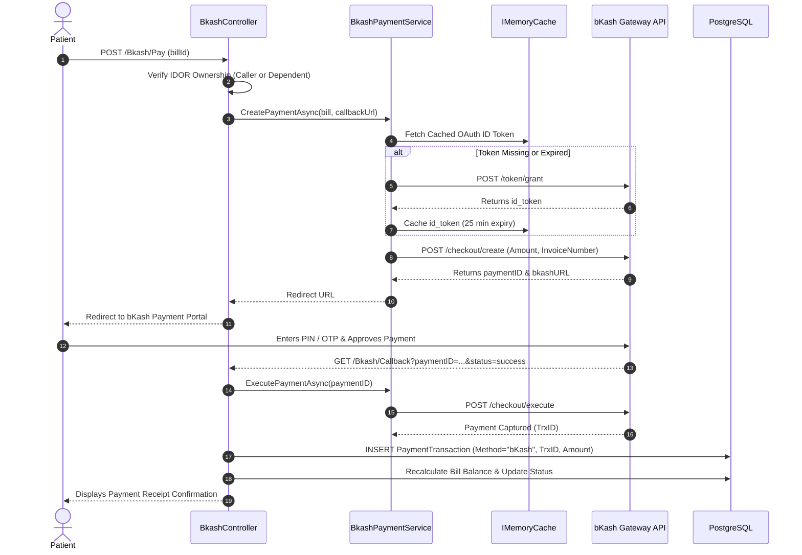
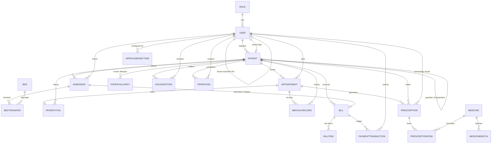

# Hospital Management System — Comprehensive System Specification & Guide

An authoritative, end-to-end technical and functional guide to the Hospital Management System. This document provides a complete explanation of the system's architecture, clinical workflows, data models, AI review pipeline, financial ledger, security guarantees, and operational procedures.

---

## Table of Contents

1. [Executive Summary & Core Value Proposition](#1-executive-summary--core-value-proposition)
2. [Complete Patient Journey & Workflows](#2-complete-patient-journey--workflows)
3. [Role-Based Functional Specifications](#3-role-based-functional-specifications)
4. [The Clinical Cockpit & Doctor Consultation](#4-the-clinical-cockpit--doctor-consultation)
5. [The Clinical AI Spine & Safety Systems](#5-the-clinical-ai-spine--safety-systems)
6. [Doctor Scheduling & Self-Service Booking](#6-doctor-scheduling--self-service-booking)
7. [Financial Architecture & bKash Payment Gateway](#7-financial-architecture--bkash-payment-gateway)
8. [Security, Privacy & Access Control Matrix](#8-security-privacy--access-control-matrix)
9. [Database Schema & Entity Reference](#9-database-schema--entity-reference)
10. [Controllers, Routes & SignalR Hubs](#10-controllers-routes--signalr-hubs)
11. [Testing & Quality Assurance Architecture](#11-testing--quality-assurance-architecture)
12. [Environment Setup & Operational Runbook](#12-environment-setup--operational-runbook)
13. [Document Index & Reading Roadmap](#13-document-index--reading-roadmap)

---

## 1. Executive Summary & Core Value Proposition

The **Hospital Management System (HMS)** is a multi-role enterprise web application engineered using **ASP.NET Core 10 MVC**, **Entity Framework Core 10**, and **PostgreSQL 18**. It models the complete clinical, administrative, and financial lifecycle of modern hospital operations.

The system is designed around six authenticated roles:
1. **Receptionist:** Front-desk registration, bed management, admission/discharge, and cashier operations.
2. **Assistant:** Clinical triage, physiological observation capture, and chamber queue routing.
3. **Doctor:** Scoped patient queues, unified consultation cockpit, AI case summaries, and safe prescribing.
4. **Pharmacist:** Real-time prescription fulfillment, atomic dispensing, and inventory tracking.
5. **Patient:** Self-service portal, dependent/child health records, slot booking, and online payment.
6. **Admin:** System governance, multi-vendor AI configurations, staff access, and analytical reporting.

### Core Architecture Pillars



- **Zero AI Clinical Direct Writes:** AI providers never write to clinical records. Outputs are staged as pending drafts requiring explicit clinician review (Accept, Edit, or Reject) before any clinical action is finalized.
- **Deterministic Clinical Safety Net:** Five deterministic checks (including hierarchical ATC classification DAG for beta-lactam cross-reactivity and clinical DDI matrix) run synchronously as pure algorithmic functions on every prescription submission without external AI dependency.
- **Immutable Financial Ledger:** Billing balances and invoice statuses are dynamically derived from a SHA-256 cryptographic hash-chained transaction ledger, eliminating accounting drift, double-entry races, and insider tampering.
- **PostgreSQL Concurrency Guarantees:** Filtered unique indexes (`ix_appointments_doctor_slot_active`) prevent simultaneous appointment double-booking collisions, while native PostgreSQL `xmin` system rowversion tokens protect against concurrent cashier double-payments and race conditions.
- **Strict Claims-Based IDOR Protection:** Patients and clinicians cannot query records outside their authorized tenancy. Route parameters are never trusted for ownership.

---

## 2. Complete Patient Journey & Workflows



### Detailed Lifecycle Phases:

1. **Intake & Identification:** The patient is registered with a hospital-wide Unique Hospital Identifier (**UHID**, e.g., `PT-202610-0001`). If requested, a patient portal account is generated immediately.
2. **Triage & Acuity Scoring:** The clinician assistant inputs 7 vital signs. The system runs the National Early Warning Score 2 (**NEWS2**) algorithm to assign an acuity rating: **Normal**, **Low**, **Medium**, or **Emergency**.
3. **Integrated Clinical Consultation:** The treating physician opens the [Clinical Cockpit](file:///home/xenaf_i/Projects/Hospital-Management-System/Controllers/DoctorDashboardController.cs#L214). The physician can review prior records, generate an AI-synthesized clinical summary, write diagnoses, and author prescriptions.
4. **Prescription Safety Verification:** On submission, the prescription safety checker analyzes medication generics against known patient allergies, existing active therapies, available stock, and pediatric age thresholds.
5. **Dispensing & Fulfillment:** The pharmacy verifies the signed prescription and dispenses medications. Physical inventory counts decrement atomically.
6. **Accounting & Checkout:** Outpatient consultations or inpatient admissions are compiled into a comprehensive bill. Bed charges across transfers are calculated automatically. Payment is received via cash at reception or online via **bKash Tokenized Checkout**.

---

## 3. Role-Based Functional Specifications

| Role | Accessible Modules | Key Functional Responsibilities | Gating Mechanism |
|---|---|---|---|
| **Admin** | Staff, AI Providers, Reports, Formulary, Beds, System Settings | Manages user credentials, configures encrypted AI keys, monitors revenue/occupancy/triage metrics. | `[Authorize(Roles = "Admin")]` |
| **Doctor** | DoctorDashboard, Clinical Cockpit, MedicalRecords, Prescriptions, AI Review | Reviews scoped consultations, enters clinical notes, generates summaries, drafts prescriptions with safety net. | `[Authorize(Roles = "Doctor")]` + Scoped `DoctorId` |
| **Assistant** | Appointments, Vitals, Patients | Manages the chamber queue for their assigned doctor, enters vital signs, executes NEWS2 triage. | `[Authorize(Roles = "Assistant")]` + Scoped `AssignedDoctorId` |
| **Pharmacist** | Prescriptions Queue, Medicines Formulary & Stock | Validates prescription orders, dispenses stock against prescriptions, manages medication pricing. | `[Authorize(Roles = "Pharmacist")]` |
| **Receptionist** | Reception Ops, Patients, Appointments, Admissions, Beds, Bills | Patient registration, doctor booking, bed allocations, bed transfers, discharge, and cash bill settlement. | `[Authorize(Roles = "Receptionist")]` |
| **Patient** | Patient Portal, Online Booking, bKash Checkout, Records | Views personal medical history, books doctor slots, manages pediatric dependents, pays bills via bKash. | `[Authorize(Roles = "Patient")]` + Claims-based IDOR checks |

---

## 4. The Clinical Cockpit & Doctor Consultation

The **Clinical Cockpit** (`/DoctorDashboard/Cockpit/{appointmentId}`) is an all-in-one clinical workspace designed to eliminate fragmented page navigation during high-pressure consultations.

```
+---------------------------------------------------------------------------------------------------------+
| CLINICAL COCKPIT — Dr. Mock (Consultant)                                                                |
+---------------------------------------------------------------------------------------------------------+
| PATIENT BANNER: Rahim Uddin (45y, Male) | UHID: PT-202610-0001 | Blood Group: B+ | Phone: 01711-000001   |
| ALLERGY ALERT: [CRITICAL] Penicillin (Anaphylaxis) | Paracetamol (Skin Rash)                           |
+---------------------------------------------------+-----------------------------------------------------+
| LEFT COLUMN: CLINICAL CONTEXT                     | RIGHT COLUMN: ACTIVE CONSULTATION & ORDERS          |
|                                                   |                                                     |
| [1] Vitals & NEWS2 Triage:                        | [3] Clinical AI Synthesis:                          |
|   - BP: 120/80 mmHg | HR: 72 bpm | RR: 16/min     |   - [Generate Case Summary Button]                  |
|   - SpO2: 98% | Temp: 37.0 C | O2: Room Air       |   - Live Token Stream (WebSocket)                   |
|   - NEWS2 Score: 0 (Normal Acuity)                |   - Verified Citations: [[rec:12]], [[rec:15]]      |
|                                                   |   - Action Gate: [Accept] [Edit] [Reject]           |
| [2] Historical Medical Records:                   |                                                     |
|   - 2026-09-10: Type 2 Diabetes Follow-up         | [4] Medical Record Entry:                           |
|   - 2026-08-01: Acute Bronchitis                  |   - Chief Complaints & Objective Findings           |
|                                                   |   - Diagnosis & Treatment Plan                      |
|                                                   |                                                     |
|                                                   | [5] Prescription Form & Safety Net:                 |
|                                                   |   - Medicine Generic Selection & Dosage             |
|                                                   |   - Real-time Safety Check Badge: 0 AI Calls        |
|                                                   |   - Duplicate Therapy & Allergy Alerts              |
|                                                   |   - Override Reason & Clinical Sign-off             |
+---------------------------------------------------+-----------------------------------------------------+
| [Complete Consultation & Send to Pharmacy]                                                              |
+---------------------------------------------------------------------------------------------------------+
```

### Consultation Completion Pipeline:
1. Validates diagnosis and prescription items.
2. Invokes [PrescriptionSafetyChecker](file:///home/xenaf_i/Projects/Hospital-Management-System/Services/PrescriptionSafetyChecker.cs) synchronously with zero-latency hierarchical ATC DAG evaluation.
3. If warnings exist, verifies doctor's documented `SafetyOverrideReason`.
4. Saves `MedicalRecord`, creates `Prescription`, and transitions `Appointment.Status` to `Completed`.
5. Broadcasts real-time SignalR notifications to update the assistant's chamber board, priority-aged queue order, and pharmacist's queue.

### 4.1 $\Delta\text{NEWS2}$ Longitudinal Deterioration Radar
In addition to static intake vitals, the Clinical Cockpit calculates the **rate of physiological deterioration** across consecutive patient observations. If a patient's NEWS2 score escalates by $\ge 2$ points within a 12-hour window, the system triggers an inline alert banner and renders a dynamic SVG sparkline polyline, notifying the clinician of rapid deterioration even if their absolute score has not yet crossed the `Emergency` threshold.

### 4.2 Tamper-Proof HMAC-Signed QR Verification
Every issued prescription and AI-generated Bangla Instruction Sheet is stamped with a cryptographically verifiable QR code generated via [PrescriptionSecurityService.cs](file:///home/xenaf_i/Projects/Hospital-Management-System/Services/PrescriptionSecurityService.cs). The payload contains `PrescriptionId`, `Uhid`, `IssuedTimestamp`, and an `HMAC-SHA256` signature generated using the server's cryptographic secret key. Scanning the QR code directs to `/Verify/Prescription?token=...` (`[AllowAnonymous]`), providing zero-friction anti-forgery verification for pharmacists, patients, and external authorities.

---

## 5. The Clinical AI Spine & Safety Systems

### 5.1 AI Case Summary Pipeline

The AI spine synthesizes comprehensive clinical history without exposing Protected Health Information (PHI) to third-party models.



#### Key Engineering Invariants:
- **Zero Automatic Clinical Mutation:** Accepting an AI suggestion updates only `AiSuggestion.Verdict`. It never directly writes or updates a `MedicalRecord` or `Prescription`.
- **Dynamic Composite Cache Invalidation:** The cache key embeds counts and latest update ticks:
  `compositeKey = $"ai-ctx-{patientId}-{records.Count}-{recordsTimestamp}-{allergies.Count}-{allergiesTimestamp}-{vitalsTimestamp}-{prescriptions.Count}-{presTimestamp}";`
  Any clinical update immediately triggers a cache miss, ensuring zero stale clinical prompts.
- **Whole-Word PHI Scrubbing:** Replaces names using word-boundary regular expressions (`\b{Name}\b`), preventing partial name corruption (e.g., preventing "Ali" from altering "Alia").
- **Stateful Streaming Lookahead Buffer:** LLM token streams emit sub-word fragments across arbitrary chunk boundaries. [ClinicalAiService.cs](file:///home/xenaf_i/Projects/Hospital-Management-System/Services/ClinicalAiService.cs) maintains a stateful lookahead buffer (`holdBackMargin`) that holds back unclosed bracket sequences (`[` or `[[`), guaranteeing that split pseudonyms (`[PATIENT_NAME]`) or citation anchors (`[[rec:12]]`) are fully rehydrated before emission and never leak raw placeholders to the clinician's display.

### 5.2 Deterministic Prescription Safety Net

Rather than relying on probabilistic language models for clinical safety, the system executes four deterministic checks in [PrescriptionSafetyChecker.cs](file:///home/xenaf_i/Projects/Hospital-Management-System/Services/PrescriptionSafetyChecker.cs):

1. **Duplicate Therapy:** Detects when two prescribed items share the same active `GenericName`, or overlap with an active dispensed prescription within its validity window.
2. **Allergy Contraindications & Drug Class Cross-Reactivity:**
   - **Cross-Reactivity Detection:** Matches drug classes rather than simplistic substring equality. For example, a recorded **Penicillin** allergy automatically catches aminopenicillins, extended-spectrum penicillins, and beta-lactams (**Amoxicillin**, **Ampicillin**, **Flucloxacillin**, **Augmentin**) by checking generic stems ending in `cillin` and therapeutic classes.
   - **Chemical Salt Disambiguation:** Differentiates true sulfonamide antibiotic allergies (**Sulfa** / **Sulfamethoxazole** / **Bactrim**) from non-allergenic chemical salts (**Sulfate** / **Sulphate** in **Morphine Sulfate**, **Salbutamol Sulfate**, **Ferrous Sulfate**), eliminating false-positive alarms on essential medications.
3. **Formulary Stock Availability:** Checks warehouse inventory; if out of stock, suggests alternative brands sharing the exact same generic molecule, sorted by available stock.
4. **Pediatric Dosing Safeguard:**
   - **Dynamic Pediatric Evaluation:** Derives pediatric status dynamically from `DateOfBirth` compared against [HospitalClock.Now](file:///home/xenaf_i/Projects/Hospital-Management-System/Services/HospitalClock.cs) (`IsPediatric`), preventing registered minors from stagnating under a static boolean.
   - **Potent Drug Overdose Protection:** While general oral solid doses (tablets/capsules) are flagged above 500mg, high-potency and narrow-therapeutic-index drugs (**Digoxin**, **Warfarin**, **Morphine**, **Prednisolone**, **Methotrexate**) trigger pediatric warnings at a strict 5mg threshold to catch dangerous overdoses in young children.
   - **Weight Tracking:** Inpatient and triage vitals record `PatientVitals.WeightKg` (0.5–350 kg) to enable accurate weight-adjusted clinical dosing.

### 5.3 Hierarchical ATC Classification DAG Engine & Drug-Drug Interaction Matrix

Engineered in [AtcClassificationGraph.cs](file:///home/xenaf_i/Projects/Hospital-Management-System/Services/AtcClassificationGraph.cs), this component elevates medication safety from simplistic text matching into an algorithmic knowledge graph:
- **Hierarchical Tree Structure:** Models the Anatomical Therapeutic Chemical (ATC) classification system as an in-memory Directed Acyclic Graph (DAG) covering all 5 anatomical and therapeutic levels:
  - Level 1: Anatomical Main Group (e.g. `J` — Anti-infectives for systemic use)
  - Level 2: Therapeutic Subgroup (e.g. `J01` — Antibacterials for systemic use)
  - Level 3: Pharmacological Subgroup (e.g. `J01C` — Beta-lactam antibacterials, penicillins)
  - Level 4: Chemical Subgroup (e.g. `J01CA` — Penicillins with extended spectrum)
  - Level 5: Chemical Substance (e.g. `J01CA04` — Amoxicillin)
- **$O(1)$ and $O(\text{depth})$ Cross-Reactivity Containment:** When an allergy is recorded (e.g., Penicillin), the graph resolves its ATC ancestor nodes. Any candidate prescription item is checked by traversing upward to common parent nodes, catching Amoxicillin, Ampicillin, and extended-spectrum cephalosporins instantly.
- **Deterministic Drug-Drug Interaction (DDI) Matrix:** Prescribed medication pairs are cross-evaluated against high-risk clinical interaction edges with zero external AI latency:
  - `Warfarin` + `Ibuprofen` / `Naproxen` $\rightarrow$ Severe gastrointestinal hemorrhage and bleeding risk.
  - `Sildenafil` + `Nitroglycerin` $\rightarrow$ Fatal refractory hypotension and cardiovascular collapse.
  - `Enalapril` / `Losartan` + `Spironolactone` $\rightarrow$ Severe hyperkalemia and cardiac arrhythmia risk.
  - `Tramadol` + `Fluoxetine` / `Sertraline` $\rightarrow$ Serotonin syndrome and seizure threshold reduction.
  - `Methotrexate` + `NSAIDs` $\rightarrow$ Renal clearance inhibition and severe methotrexate toxicity.

---

## 6. Doctor Scheduling & Self-Service Booking

### 6.1 Doctor Schedule Engine

Managed by [DoctorScheduleService.cs](file:///home/xenaf_i/Projects/Hospital-Management-System/Services/DoctorScheduleService.cs):
- **Working Window:** 09:00 AM to 05:00 PM (17:00), Monday through Sunday.
- **Slot Granularity:** Fixed 15-minute consultation intervals.
- **Timezone Awareness:** All calculations use [HospitalClock](file:///home/xenaf_i/Projects/Hospital-Management-System/Services/HospitalClock.cs) locked to Bangladesh Standard Time (**Asia/Dhaka, UTC+6**).
- **Collision Detection & Concurrency Architecture:**
  - `CheckDoctorCollisionAsync`: Verifies doctor is not double-booked for outpatient appointments AND cross-checks active surgical theatre bookings in the `Operations` table so surgeons are not scheduled in clinic while operating in the OT.
  - `CheckPatientCollisionAsync`: Verifies patient does not hold overlapping appointments across doctors.
  - **PostgreSQL Filtered Unique Index:** To prevent race conditions during simultaneous slot booking, the database enforces a filtered unique index:
    ```sql
    CREATE UNIQUE INDEX ix_appointments_doctor_slot_active 
    ON "Appointments" ("DoctorId", "AppointmentDatetime") 
    WHERE "Status" <> 2; -- 2 = Cancelled
    ```
    *Why this is required:* PostgreSQL `xmin` concurrency tokens operate strictly on `UPDATE` and `DELETE` of existing rows. Concurrent bookings execute simultaneous `INSERT` statements; `xmin` cannot detect new row collisions. The filtered unique index guarantees atomic, race-free slot claiming at the database engine level, while `xmin` guards subsequent status modifications.

### 6.2 Patient Portal & Pediatric Family Accounts

The patient portal (`/Portal`) allows authenticated patients to manage their own healthcare and that of their pediatric dependents:
- **Pediatric Dependents Linkage:** Children are linked via `Patient.GuardianPatientId`.
- **Active Profile Switching:** Parents can seamlessly toggle between their personal chart and their children's charts.
- **Strict IDOR Isolation:** The patient portal enforces claims-based boundaries:
  ```csharp
  var allowedIds = new HashSet<int>(dependents.Select(d => d.Id)) { primaryPatient.Id };
  if (!allowedIds.Contains(requestedPatientId))
  {
      return Forbid(); // IDOR violation attempt blocked
  }
  ```

### 6.3 Dynamic Acuity-Weighted Queue with Starvation Prevention (Aging Algorithm)

Managed by [AcuityQueueService.cs](file:///home/xenaf_i/Projects/Hospital-Management-System/Services/AcuityQueueService.cs) and broadcast in real-time via `NotificationHub`:
- **Priority-Aging Scoring Formula:**
  $$\text{PriorityScore} = (W_{\text{acuity}} \times \text{NEWS2}) + (W_{\text{wait}} \times \text{MinutesWaited})$$
  *(Default calibration: $W_{\text{acuity}} = 10.0$, $W_{\text{wait}} = 1.0$)*
- **Starvation Prevention Invariant:** High-acuity patients (NEWS2 $\ge 5$, Emergency) are fast-tracked to the top of the chamber queue. However, the continuous linear aging term ($W_{\text{wait}} \times \text{MinutesWaited}$) guarantees that stable walk-ins (`Normal` acuity) are never indefinitely starved by successive incoming patients.
- **Live Estimated Wait Time (EWT):** Computed dynamically based on queue rank and estimated 15-minute slot durations, streamed directly to waiting patients on `/Portal` and assistants on `/Appointments`.

---

## 7. Financial Architecture & bKash Payment Gateway

### 7.1 Cryptographic Hash-Chained Financial Ledger (Tamper-Evident Auditing)

Financial integrity is enforced through an append-only cryptographic ledger similar to Git commit trees or blockchain transaction ledgers:
- **Cryptographic Hash Chain:** Every [PaymentTransaction](file:///home/xenaf_i/Projects/Hospital-Management-System/Models/PaymentTransaction.cs) stores:
  - `PreviousHash`: The SHA-256 digest of the immediate preceding transaction (or `"GENESIS_BLOCK"` for the root entry).
  - `RowHash`: `SHA-256(PreviousHash + TransactionId + Amount + TimestampUtc + ProcessedById)`.
- **One-Click Ledger Integrity Verification:** Implemented in [LedgerIntegrityService.cs](file:///home/xenaf_i/Projects/Hospital-Management-System/Services/LedgerIntegrityService.cs) and exposed on `/Reports/VerifyLedgerIntegrity` (`[Authorize(Roles = "Admin")]`). The service scans all ledger rows in $O(N)$ time:
  - Recomputes each transaction's SHA-256 hash.
  - Verifies that `tx[i].PreviousHash == tx[i-1].RowHash`.
  - If an insider database administrator alters an historical payment amount or transaction ID directly in PostgreSQL, verification fails immediately, citing the exact corrupted transaction ID, row index, and recorded amount.
- **Ledger Balances & State Recalculation:** Payments never mutate `Bill.PaidAmount` directly. `RecalculateTotals()` derives totals by summing verified `PaymentTransactions`:
  ```csharp
  public void RecalculateTotals()
  {
      if (BillItems == null || PaymentTransactions == null)
      {
          throw new InvalidOperationException("BillItems and PaymentTransactions navigation collections must be loaded before recalculating totals.");
      }

      PaidAmount = PaymentTransactions.Sum(t => t.Amount);

      SubtotalAmount = BillItems.Sum(i => i.Amount);
      NetTotal = Math.Max(0, SubtotalAmount - DiscountAmount);
      
      // Only transition to Paid when the invoice has billable items and the balance is settled
      if (SubtotalAmount > 0 && (NetTotal == 0 || PaidAmount >= NetTotal))
          Status = BillStatus.Paid;
      else if (PaidAmount > 0)
          Status = BillStatus.PartiallyPaid;
      else
          Status = BillStatus.Unpaid;
  }
  ```
- **Null-Navigation Protection:** Guarding against null `BillItems` or `PaymentTransactions` prevents queries executed without `.Include(...)` from evaluating totals with missing collections and inadvertently corrupting bill status or payment balances.
- **Idempotency & Gateway Duplicate Protection:** A filtered unique index on `PaymentTransactions.TransactionId` (`WHERE "TransactionId" IS NOT NULL`) stops double-clicks, browser refreshes, and concurrent callback retries from recording duplicate payments.

### 7.2 bKash Tokenized Checkout Integration

Managed by [BkashPaymentService.cs](file:///home/xenaf_i/Projects/Hospital-Management-System/Services/BkashPaymentService.cs) and [BkashController.cs](file:///home/xenaf_i/Projects/Hospital-Management-System/Controllers/BkashController.cs):



---

## 8. Security, Privacy & Access Control Matrix

### 8.1 Inverted Authorization Fallback Policy

By default, ASP.NET Core endpoints are anonymous unless annotated. The HMS inverts this default in [Program.cs](file:///home/xenaf_i/Projects/Hospital-Management-System/Program.cs#L26-L31):
```csharp
builder.Services.AddAuthorization(options =>
{
    options.FallbackPolicy = new AuthorizationPolicyBuilder()
        .RequireAuthenticatedUser()
        .Build();
});
```
Every endpoint is strictly closed by default; public endpoints (e.g., `/Auth/Login`) must explicitly opt-out via `[AllowAnonymous]`.

### 8.2 Role Permissions Matrix

| Controller / Resource | Anonymous | Patient | Assistant | Doctor | Pharmacist | Receptionist | Admin |
|---|:---:|:---:|:---:|:---:|:---:|:---:|:---:|
| `Auth/Login` | Allowed | Allowed | Allowed | Allowed | Allowed | Allowed | Allowed |
| `Verify/Prescription` | **Allowed** | Allowed | Allowed | Allowed | Allowed | Allowed | Allowed |
| `Portal/*` | Denied | **Scoped** | Denied | Denied | Denied | Denied | Denied |
| `DoctorDashboard/*` | Denied | Denied | Denied | **Scoped** | Denied | Denied | Denied |
| `Appointments/Book` | Denied | Via Portal | Denied | Denied | Denied | Full | Full |
| `Operations/*` | Denied | Denied | Denied | **Scoped** | Denied | **Full** | **Full** |
| `Vitals/Create` | Denied | Denied | **Chamber** | Read-Only | Denied | Denied | Full |
| `Prescriptions/Create` | Denied | Denied | Denied | **Active** | Denied | Denied | Full |
| `Prescriptions/Dispense` | Denied | Denied | Denied | Denied | **Full** | Denied | Full |
| `Admissions/*` | Denied | Denied | Denied | View | Denied | **Full** | Full |
| `Bills/RecordPayment` | Denied | Via bKash | Denied | Denied | Denied | **Cash** | Full |
| `AiProviderSettings/*` | Denied | Denied | Denied | Denied | Denied | Denied | **Full** |
| `Staff/*` | Denied | Denied | Denied | Denied | Denied | Denied | **Full** |
| `Reports/*` | Denied | Denied | Denied | Denied | Denied | Denied | **Full** |

---

## 9. Database Schema & Entity Reference

The database consists of **20 relational tables** configured in [ApplicationDbContext.cs](file:///home/xenaf_i/Projects/Hospital-Management-System/Models/ApplicationDbContext.cs):



### Table Definitions & Key Properties:

1. **`Roles` (`Role`):** Defines system roles and permission sets (`Admin`, `Doctor`, `Assistant`, `Pharmacist`, `Receptionist`, `Patient`).
2. **`Users` (`User`):** Staff accounts and patient authentication identities. Maps BCrypt password hashes and self-referencing `AssignedDoctorId`.
3. **`Patients` (`Patient`):** Core demographic registry. Contains `Uhid` (UK), `IsChild`, dynamic `IsPediatric` (derived from `DateOfBirth` and `HospitalClock.Now`), `GuardianPatientId` (FK, self-ref), and `UserId` (FK, portal login).
4. **`Beds` (`Bed`):** Bed inventory with category classifications (`GeneralWard`, `Cabin`, `ICU`, `VIPCabin`) and daily rates.
5. **`BedTransfers` (`BedTransfer`):** Tracks occupancy periods (`StartDate`, `EndDate`) for inpatient stays.
6. **`Admissions` (`Admission`):** Inpatient admission records linking patient, admitting doctor, and bed transfers.
7. **`Appointments` (`Appointment`):** Outpatient booking slots with `AppointmentDatetime`, `EndTime`, `Status`, filtered unique index `ix_appointments_doctor_slot_active` (`WHERE "Status" <> 2` preventing concurrent `INSERT` double bookings), and native `Version` (`xmin` optimistic concurrency token).
8. **`PatientVitals` (`PatientVital`):** Observation data: BP, HR, RR, SpO2, Temperature, `WeightKg` (0.5–350kg for pediatric weight-adjusted dosing), Supplemental O2, Consciousness, and computed `NEWS2` score/priority.
9. **`MedicalRecords` (`MedicalRecord`):** Consultation notes, diagnoses, and treatment summaries.
10. **`PatientAllergies` (`PatientAllergy`):** Documented substance allergies with severity, drug class mapping, and a server-computed normalized shadow column.
11. **`Medicines` (`Medicine`):** Formulary inventory with brand name, generic name, strength, unit price, and aggregate stock count. Stock deductions execute atomically via `ExecuteUpdateAsync` with a `WHERE StockQuantity >= requested` SQL guard to eliminate race conditions and negative inventory.
12. **`MedicineBatches` (`MedicineBatch`):** Sub-entity tracking individual manufacturing batches (`BatchNumber`, `ExpiryDate`, `QuantityRemaining`, `InitialQuantity`) enabling FEFO (First-Expired, First-Out) inventory allocation, automatic lockout of expired stock, and near-expiry alerts.
13. **`Prescriptions` (`Prescription`):** Clinical medication orders with dispensing lifecycle tracking (`DispensedById`, `DiscontinuedById`), safety override audit JSON, and HMAC-SHA256 verification stamps.
14. **`PrescriptionItems` (`PrescriptionItem`):** Specific dosage, frequency, and quantity lines linked to formulary medicines.
15. **`Bills` (`Bill`):** Billing invoices mapping subtotal, discounts, net balance, paid totals, and native `Version` (`xmin` concurrency token).
16. **`BillItems` (`BillItem`):** Line items specifying department charges (Pharmacy, Bed, Consultation, Operation, Diagnostics).
17. **`PaymentTransactions` (`PaymentTransaction`):** Cryptographic hash-chained financial ledger recording payment amounts, methods (Cash, bKash, Card), cashier IDs, `PreviousHash`, `RowHash` (`SHA-256`), and filtered unique index on `TransactionId` (`WHERE "TransactionId" IS NOT NULL`) for gateway idempotency.
18. **`AiSuggestions` (`AiSuggestion`):** Generated AI clinical drafts (Case Summaries or Bangla Instructions) with token usage, latency, and clinician verdict.
19. **`AiProviderSettings` (`AiProviderSetting`):** Multi-vendor configurations storing encrypted API keys, model identifiers, and failover priority ranks.
20. **`Operations` (`Operation`):** End-to-end surgical theatre scheduling engine validating surgeon availability, operating theatre availability, and automatic post-op recovery bed reservation via `BedTransfers`.

---

## 10. Controllers, Routes & SignalR Hubs

### 10.1 Web Controllers

| Controller | Route Prefix | Primary Purpose |
|---|---|---|
| [AuthController](file:///home/xenaf_i/Projects/Hospital-Management-System/Controllers/AuthController.cs) | `/Auth` | Login authentication, logout, cookie issuance, and development quick-login bypass. |
| [ReceptionController](file:///home/xenaf_i/Projects/Hospital-Management-System/Controllers/ReceptionController.cs) | `/Reception` | Operations landing page: today's queue metrics, bed occupancy, admissions, and unpaid bills. |
| [PatientsController](file:///home/xenaf_i/Projects/Hospital-Management-System/Controllers/PatientsController.cs) | `/Patients` | Patient directory, search lookup endpoints, registration, and profile management. |
| [AppointmentsController](file:///home/xenaf_i/Projects/Hospital-Management-System/Controllers/AppointmentsController.cs) | `/Appointments` | Hospital-wide appointment scheduling, status tracking, and receptionist queue management. |
| [DoctorDashboardController](file:///home/xenaf_i/Projects/Hospital-Management-System/Controllers/DoctorDashboardController.cs) | `/DoctorDashboard` | Doctor chamber queue, single-screen **Clinical Cockpit**, and consultation finalization. |
| [VitalsController](file:///home/xenaf_i/Projects/Hospital-Management-System/Controllers/VitalsController.cs) | `/Vitals` | Vitals intake form, NEWS2 calculation display, and patient send-in workflow. |
| [MedicalRecordsController](file:///home/xenaf_i/Projects/Hospital-Management-System/Controllers/MedicalRecordsController.cs) | `/MedicalRecords` | Longitudinal patient clinical records with server-side pagination. |
| [PrescriptionsController](file:///home/xenaf_i/Projects/Hospital-Management-System/Controllers/PrescriptionsController.cs) | `/Prescriptions` | Medication prescription creation, deterministic safety checks, print views, and pharmacy queue. |
| [MedicinesController](file:///home/xenaf_i/Projects/Hospital-Management-System/Controllers/MedicinesController.cs) | `/Medicines` | Hospital pharmacy formulary management and stock inventory auditing. |
| [AdmissionsController](file:///home/xenaf_i/Projects/Hospital-Management-System/Controllers/AdmissionsController.cs) | `/Admissions` | Bed allocation, inpatient admission, bed transfers, and patient discharge. |
| [BedsController](file:///home/xenaf_i/Projects/Hospital-Management-System/Controllers/BedsController.cs) | `/Beds` | Hospital physical bed setup, daily rates, and maintenance management. |
| [BillsController](file:///home/xenaf_i/Projects/Hospital-Management-System/Controllers/BillsController.cs) | `/Bills` | Invoice compilation, bed charge auto-calculation, discounts, and cash payment collection. |
| [BkashController](file:///home/xenaf_i/Projects/Hospital-Management-System/Controllers/BkashController.cs) | `/Bkash` | bKash tokenized payment checkout, callback verification, and transaction recording. |
| [PortalController](file:///home/xenaf_i/Projects/Hospital-Management-System/Controllers/PortalController.cs) | `/Portal` | Self-service portal for patients and pediatric dependents (booking, records, bills). |
| [AiReviewController](file:///home/xenaf_i/Projects/Hospital-Management-System/Controllers/AiReviewController.cs) | `/AiReview` | Streaming endpoints for AI case summaries and Bangla sheets; Accept/Edit/Reject review actions. |
| [AiProviderSettingsController](file:///home/xenaf_i/Projects/Hospital-Management-System/Controllers/AiProviderSettingsController.cs) | `/AiProviderSettings` | Admin configuration for external LLMs (Gemini, Groq, Anthropic), priorities, and health pings. |
| [StaffController](file:///home/xenaf_i/Projects/Hospital-Management-System/Controllers/StaffController.cs) | `/Staff` | Staff user administration, role assignment, and doctor-assistant pairing. |
| [ReportsController](file:///home/xenaf_i/Projects/Hospital-Management-System/Controllers/ReportsController.cs) | `/Reports` | Executive dashboard: revenue, occupancy, triage mix, AI governance, ledger integrity verification, and safety net stats. |
| [OperationsController](file:///home/xenaf_i/Projects/Hospital-Management-System/Controllers/OperationsController.cs) | `/Operations` | Surgical theatre scheduling engine validating surgeon, OT room, and recovery bed constraints simultaneously. |
| [VerifyController](file:///home/xenaf_i/Projects/Hospital-Management-System/Controllers/VerifyController.cs) | `/Verify` | Public, unauthenticated verification endpoint for HMAC-signed prescription and instruction sheet QR codes. |
| [PatientAllergiesController](file:///home/xenaf_i/Projects/Hospital-Management-System/Controllers/PatientAllergiesController.cs) | `/PatientAllergies` | Patient allergy recording and deletion. |

### 10.2 Real-Time SignalR Hubs

1. **`NotificationHub` (`/notificationHub`):**
   - Annotated with `[Authorize]`.
   - On connection, maps the caller to their private channel group `user_{userId}`.
   - Pushes live updates when an assistant sends a patient in, keeping the doctor's consultation board dynamically updated without browser reloads. Broadcasts dynamic acuity-aged queue reordering and EWT estimations.
2. **`AiStreamHub` (`/aiStreamHub`):**
   - Annotated with `[Authorize(Roles = "Doctor")]`.
   - Enforces that only the initiating doctor can join stream channel groups (`JoinStream`).
   - Streams rehydrated AI tokens in real time directly to the doctor's screen.

---

## 11. Testing & Quality Assurance Architecture

The test suite contains **310 automated xUnit tests** with zero external database dependencies (using EF Core In-Memory and Mocked Handlers), providing 100% test pass rates in ~4 seconds:

```bash
dotnet test
Passed! - Failed: 0, Passed: 310, Skipped: 0, Total: 310, Duration: 4 s
```

> [!NOTE]
> **Test Boundary Notice (Application vs Relational Engine):**
> The xUnit test suite executes against EF Core In-Memory for ultra-fast, zero-dependency CI runs. In-memory tests validate application-layer invariants, model relationships, business calculations, balance constraints, rollback handlers, and authorization policies. Physical relational constraints—including the PostgreSQL filtered unique index `ix_appointments_doctor_slot_active` (`WHERE "Status" <> 2`), the unique payment transaction index, database-level foreign key delete behaviors (`RESTRICT`/`CASCADE`), and PostgreSQL `xmin` concurrency rowversion locks—are enforced in production by the PostgreSQL database engine via the applied migration schema.

### Test Suite Partitioning:

```
tests/HospitalManagementSystem.Tests/
├── News2CalculatorTests.cs                   (65 tests: Boundary values on all 7 vital parameters & single red score)
├── EdgeCases/
│   ├── News2BoundaryTests.cs                 (15 tests: Physiological range extremes & pediatric score withholding)
│   ├── AllergyContraindicationTests.cs       (12 tests: Case-insensitive, drug class cross-reactivity, salt disambiguation, potent pediatric checks)
│   └── DuplicateTherapyTests.cs              (8 tests: Same generic active therapies & window expiry rules)
├── PrescriptionSafetyCheckerTests.cs         (11 tests: Unit tests for all 4 safety net rules, ATC graph cross-reactivity, & override requirements)
├── BillTotalsTests.cs                        (15 tests: Subtotals, net totals, fully discounted bills, ledger math, null-navigation guards on BillItems & PaymentTransactions)
├── LedgerIntegrityTests.cs                   (6 tests: Genesis SHA-256 block calculation, chain hash propagation, valid chain verification, and tamper detection)
├── AcuityQueueTests.cs                       (5 tests: Priority score aging formula, starvation prevention, live EWT estimation, and longitudinal ΔNEWS2 ≥ 2 deterioration)
├── FefoInventoryTests.cs                     (4 tests: Earliest-expiry batch consumption, partial multi-batch deductions, expired batch lockout, and near-expiry alerting)
├── PrescriptionSecurityTests.cs              (5 tests: HMAC-SHA256 token signing, tamper rejection, expired token rejection, and valid token payload decoding)
├── OperationSchedulingTests.cs               (5 tests: Surgeon schedule collision detection, operating theatre double-booking prevention, and post-op ICU/Cabin bed reservation)
├── HospitalClockTests.cs                     (6 tests: Asia/Dhaka UTC+6 conversions & day boundary calculations)
├── PhiScrubberTests.cs                       (8 tests: Whole-word regex scrubbing & pseudonym reversal round trips)
├── Ai/
│   └── AiResponseSanitizationTests.cs        (7 tests: Hallucinated citation stripping & streaming error handling)
├── AiProviderPingTests.cs                    (6 tests: Vendor connectivity diagnostics for Gemini, Groq, Anthropic)
├── AiProviderFallbackTests.cs                (6 tests: Failover chain execution, retry logic, and fallback order)
├── Integration/
│   ├── ReferentialIntegrityTests.cs          (5 tests: Blocking deletion of prescribed drugs and billed admissions)
│   ├── BillPaymentConcurrencyTests.cs        (4 tests: PostgreSQL xmin token concurrency & overpayment prevention)
│   ├── AppointmentConflictIntegrationTests.cs(6 tests: Doctor slot collisions & simultaneous double-booking prevention)
│   ├── DoctorClinicalCockpitIntegrationTests.cs(6 tests: Cockpit data loading, consultation completion, stale filtering)
│   └── PharmacyDispensingIntegrationTests.cs (4 tests: Atomic stock deductions & duplicate dispensing blocks)
├── Portal/
│   ├── PatientBookingTests.cs                (14 tests: 15-minute slot allocation, rescheduling, cancellation guards)
│   ├── DependentFamilyAccountTests.cs        (15 tests: Family account switching, guardian permissions, IDOR isolation)
│   ├── BkashPaymentServiceTests.cs           (10 tests: OAuth token caching, checkout creation, execute payment)
│   └── BkashControllerTests.cs               (12 tests: Payment initiation, callback verification, ledger insertion)
└── Security/
    ├── PatientPortalIsolationTests.cs        (10 tests: Enforcing zero cross-patient data leaks via URL manipulation)
    ├── DoctorAccessControlTests.cs           (8 tests: Doctor chamber isolation & unauthorized consultation guards)
    ├── AssistantAccessControlTests.cs        (8 tests: Chamber queue scoping for assigned assistants)
    ├── AiReviewSecurityTests.cs              (9 tests: Doctor-only AI review actions & atomic verdict transitions)
    └── StaffManagementSecurityTests.cs       (8 tests: Admin-only staff mutations & password hash integrity)
```

---

## 12. Environment Setup & Operational Runbook

### Prerequisites:
- **.NET 10 SDK** (v10.0.100+)
- **PostgreSQL 12+** (Developed and tested against PostgreSQL 18)
- `dotnet-ef` tool (`dotnet tool install --global dotnet-ef`)

### Step-by-Step Clean Setup:

1. **Clone repository & restore dependencies:**
   ```bash
   git clone <repo-url>
   cd Hospital-Management-System
   dotnet restore
   ```

2. **Configure PostgreSQL connection string via user-secrets:**
   ```bash
   dotnet user-secrets set "ConnectionStrings:DefaultConnection" "Host=localhost;Port=5432;Database=HospitalDB;Username=postgres;Password=<your-password>"
   ```

3. **Configure optional external vendor API keys:**
   ```bash
   dotnet user-secrets set "Gemini:ApiKey" "<your-gemini-key>"
   dotnet user-secrets set "Groq:ApiKey" "<your-groq-key>"
   ```
   *(Note: AI keys can also be set post-launch via the Admin UI at `/AiProviderSettings`).*

4. **Apply EF Core database migrations:**
   ```bash
   dotnet ef database update
   ```

5. **Seed demo data (Idempotent CLI command):**
   ```bash
   dotnet run -- --seed-demo
   ```

6. **Run the web application:**
   ```bash
   dotnet run
   ```
   Navigate to `http://localhost:5004/Auth/Login`.

### Pre-Configured Demo Credentials:

| Role | Username | Password (Dev / Production) | Special Notes |
|---|---|---|---|
| **Admin** | `admin` | *One-Click Login* / `Passw0rd!` | System Administrator |
| **Doctor (Lead)** | `drmock` | *One-Click Login* / `Passw0rd!` | Consultant Physician |
| **Doctor (2nd)** | `dr2` | `Passw0rd!` | Second Doctor for Multi-Login Demo |
| **Assistant** | `mock-assistant`| *One-Click Login* / `Passw0rd!` | Assigned to Dr. Mock |
| **Assistant (2nd)**| `assistant2` | `Passw0rd!` | Assigned to Dr. 2 |
| **Pharmacist** | `pharmacistmock`| *One-Click Login* / `Passw0rd!` | Pharmacy Lead |
| **Receptionist** | `reception1` | *One-Click Login* / `Passw0rd!` | Front Desk Lead |
| **Patient (Primary)**| `PT-202610-0001`| `Patient@123` | Rahim Uddin (Father of Ayan Uddin) |
| **Patient (Family)**| `PT-202610-0002`| `Patient@123` | Fatema Begum (Mother of Zara Begum) |

---

## 13. Document Index & Reading Roadmap

Depending on the stakeholder or reader's role, recommend the following reading paths:

| Stakeholder / Persona | Primary Recommended Document | Secondary Documents |
|---|---|---|
| **Examiner / Defense Panel** | [docs/DEFENSE-NOTES.md](file:///home/xenaf_i/Projects/Hospital-Management-System/docs/DEFENSE-NOTES.md) (Script & Q&A) | [docs/SYSTEM-GUIDE.md](file:///home/xenaf_i/Projects/Hospital-Management-System/docs/SYSTEM-GUIDE.md) (Master Spec) |
| **Software Architect / Lead** | [docs/ARCHITECTURE.md](file:///home/xenaf_i/Projects/Hospital-Management-System/docs/ARCHITECTURE.md) (Data Flows & Auth) | [docs/ER-DIAGRAM.md](file:///home/xenaf_i/Projects/Hospital-Management-System/docs/ER-DIAGRAM.md) (Database ERD) |
| **Frontend Engineer / UI Designer** | [docs/FRONTEND.md](file:///home/xenaf_i/Projects/Hospital-Management-System/docs/FRONTEND.md) (Design Tokens, Workstations, SignalR) | [docs/SYSTEM-GUIDE.md](file:///home/xenaf_i/Projects/Hospital-Management-System/docs/SYSTEM-GUIDE.md) (UI Workflows) |
| **Database Engineer / DBA** | [docs/ER-DIAGRAM.md](file:///home/xenaf_i/Projects/Hospital-Management-System/docs/ER-DIAGRAM.md) (All 20 Tables) | [docs/SYSTEM-GUIDE.md](file:///home/xenaf_i/Projects/Hospital-Management-System/docs/SYSTEM-GUIDE.md#9-database-schema--entity-reference) |
| **Clinical User / Hospital Admin** | [docs/SYSTEM-GUIDE.md](file:///home/xenaf_i/Projects/Hospital-Management-System/docs/SYSTEM-GUIDE.md) (Complete Manual) | [README.md](file:///home/xenaf_i/Projects/Hospital-Management-System/README.md) (Quickstart & Setup) |
| **New Developer / Contributor** | [README.md](file:///home/xenaf_i/Projects/Hospital-Management-System/README.md) & [docs/SYSTEM-GUIDE.md](file:///home/xenaf_i/Projects/Hospital-Management-System/docs/SYSTEM-GUIDE.md) | [docs/ARCHITECTURE.md](file:///home/xenaf_i/Projects/Hospital-Management-System/docs/ARCHITECTURE.md) & [docs/FRONTEND.md](file:///home/xenaf_i/Projects/Hospital-Management-System/docs/FRONTEND.md) |
